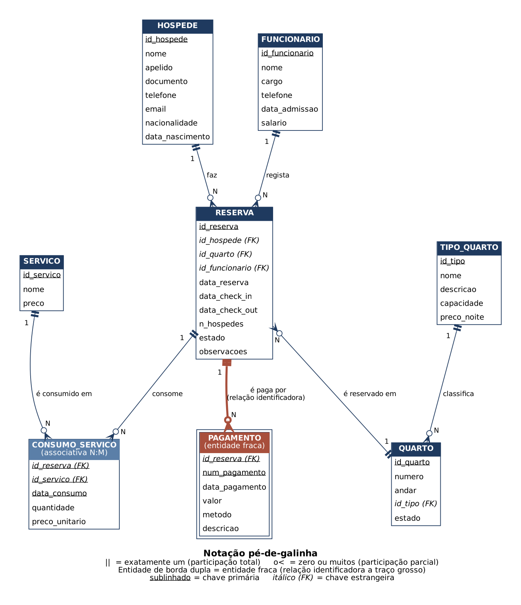

# Base de Dados — Gestão de Hotel

**Autor:** Edwin Taimo 
**Curso:** Licenciatura em Informática, 2.º ano — Universidade Licungo  
**Disciplina:** Tecnologias de Base de Dados  
**Trabalho II:** Projeto de uma Base de Dados  
**Tema:** Hotel  


> **Vídeo de apresentação:** [COLAR AQUI O LINK DO YOUTUBE]

---

## 1. Descrição do problema

Um hotel de média dimensão gere hoje as reservas, os hóspedes e os pagamentos em cadernos e folhas de cálculo soltas. Isto causa problemas frequentes: reservas duplicadas para o mesmo quarto e as mesmas datas, perda do histórico dos hóspedes, dificuldade em saber quais quartos estão livres e valores de contas calculados à mão, com erros.

Esta base de dados centraliza a informação do hotel. O rececionista regista o hóspede, escolhe um quarto de determinado tipo e cria a reserva com as datas de entrada e saída. Durante a estadia, os serviços extra consumidos (refeições, lavandaria, transfer, spa, etc.) ficam associados à reserva. O hóspede paga em um ou mais pagamentos (por exemplo, sinal na reserva e liquidação no check-out) por numerário, cartão, M-Pesa, e-Mola ou transferência. A partir destes dados é possível consultar a ocupação, o histórico de cada hóspede e o valor total de cada conta.

## 2. Regras de negócio

1. Um hóspede é identificado de forma única pelo seu documento (BI ou passaporte).
2. Cada quarto pertence a exatamente um tipo de quarto; o tipo define a capacidade e o preço por noite.
3. O número do quarto é único no hotel.
4. O estado de um quarto é um de: *Disponível*, *Ocupado* ou *Manutenção*.
5. Uma reserva é feita por um hóspede, para um quarto, e é registada por um funcionário (rececionista).
6. A data de check-out tem de ser posterior à data de check-in.
7. O número de hóspedes de uma reserva não pode exceder a capacidade do tipo de quarto.
8. O estado de uma reserva é um de: *Confirmada*, *Em curso*, *Concluída* ou *Cancelada*.
9. Os serviços extra consumidos são associados à reserva; o preço cobrado fica guardado no momento do consumo.
10. Um pagamento só existe associado a uma reserva (entidade fraca) e cada reserva pode ter vários pagamentos, numerados em sequência.
11. O total de uma reserva é calculado: noites × preço da noite + serviços consumidos.
12. Não é permitido eliminar registos que tenham dependentes (ex.: uma reserva com pagamentos).

## 3. Sistema web previsto

Na disciplina de Programação Web será desenvolvido um sistema web de gestão do hotel sobre esta base de dados.

- **Utilizadores:** rececionistas (operação diária), gerente (relatórios e gestão) e, numa fase seguinte, hóspedes (consulta e pedido de reservas).
- **Funcionalidades previstas:**
  - registar, listar, pesquisar, alterar e eliminar hóspedes;
  - consultar quartos disponíveis por datas e tipo;
  - criar, alterar e cancelar reservas; fazer check-in e check-out;
  - registar consumo de serviços e pagamentos;
  - emitir a conta final de cada reserva;
  - relatórios: ocupação por período, receitas e serviços mais consumidos.

## 4. Modelo de dados

### Diagrama Entidade-Relacionamento



### Entidades

| Entidade | Descrição |
|---|---|
| HOSPEDE | Pessoa que se hospeda no hotel |
| FUNCIONARIO | Trabalhador do hotel (rececionista, camareira, etc.) |
| TIPO_QUARTO | Categoria de quarto com capacidade e preço por noite |
| QUARTO | Quarto físico do hotel |
| RESERVA | Reserva de um quarto por um hóspede |
| SERVICO | Serviço extra oferecido (refeições, spa, transfer...) |
| CONSUMO_SERVICO | Tabela associativa entre reserva e serviço (N:M) |
| PAGAMENTO | **Entidade fraca**: pagamentos de uma reserva |

O modelo relacional completo, com chaves, cardinalidades e participação, está em [`modelo_relacional.md`](modelo_relacional.md).

## 5. Estrutura do repositório

```
bd-hotel-edwin-apelido/
  README.md
  diagrama_er.png
  modelo_relacional.md
  01_criacao_e_insercao.sql
  02_manipulacao.sql
```

## 6. Como executar

1. Instalar o MySQL (ou MariaDB) e abrir um terminal ou o MySQL Workbench.
2. Criar a base de dados, as tabelas e inserir os registos (mínimo de 20 por tabela):
   ```bash
   mysql -u root -p < 01_criacao_e_insercao.sql
   ```
3. Executar os comandos de manipulação (SELECT, JOIN, UPDATE, DELETE e teste de integridade):
   ```bash
   mysql -u root -p hotel_db < 02_manipulacao.sql
   ```
   O último comando do ficheiro (secção E) falha **de propósito**, para demonstrar a integridade referencial.

### Registos inseridos

| Tabela | Registos |
|---|---|
| hospede | 25 |
| funcionario | 20 |
| tipo_quarto | 20 |
| servico | 20 |
| quarto | 25 |
| reserva | 25 |
| consumo_servico | 32 |
| pagamento | 33 |
